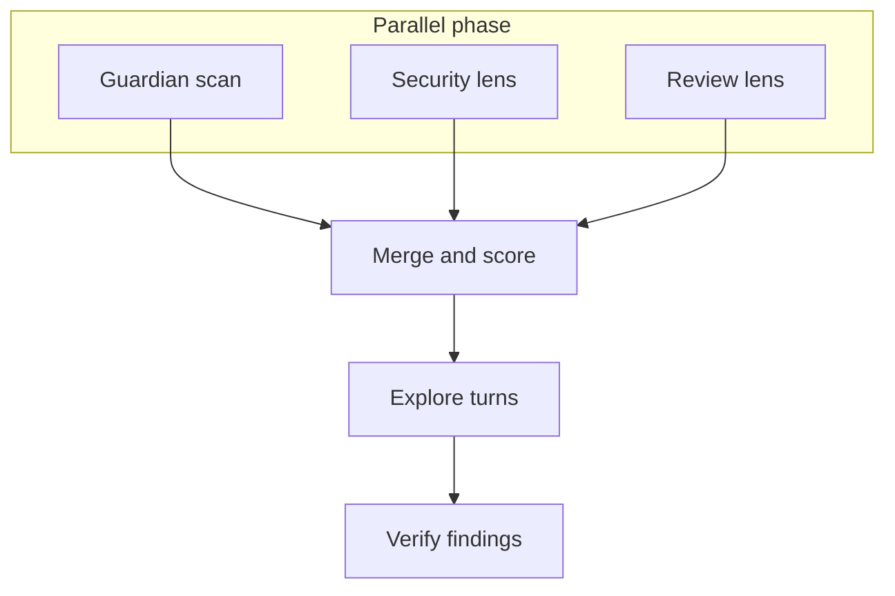

# Architecture

## One role, three entry points

`roles/review/` is the single role behind every review type
(`review_type=pr|branch|commit`). Earlier in the project's history these
were three separate roles (`pr_review`, `branch_review`, `code_review`);
they were consolidated into one, dispatching on `review_type` rather than
duplicating the pipeline three times.

`roles/review/tasks/main.yml` dispatches on `review_type` (`pr`, `branch`, or `commit`) to `resolve_target_{{ review_type }}.yml`. That file resolves the target into the variables the shared engine expects (`review_repo_path`, `review_org_repo`, `review_branch`, `review_context`, `review_short_sha`), then calls `run_review_engine.yml`. `resolve_target_*.yml` is the only target-specific logic. `briefing.yml`, `lenses.yml`, `merge.yml`, `explore.yml`, `verify.yml`, and `persist.yml` are the shared engine.

`review_type: pr` detects GitHub or GitLab from the target, fetches the pull request or merge request, and resolves the head ref. Posting is a step after the engine, and it stays off unless `post_results` is true. That post step is why each `resolve_target_*.yml` calls the engine itself. `review_type: commit` validates a local commit with git. `review_type: branch` resolves a local, GitHub, or GitLab branch.

Pull-request and branch reviews run briefing inside an OpenShell sandbox by default, because that stage runs commands taken from the change under review. Commit review does not. See [Sandboxes and LLM calls](sandbox-and-agent-safety.md).

There is no `bug_pipeline.yml` on `main`. That playbook is parked on `wip/bug-fix-pipeline`.

## Stages

1. **Briefing** (`briefing.yml`). Diff, domain detection, prior-review lookup, and checklist execution. No model call.
2. **Lenses** (`lenses.yml`). A Security lens and a Functionality/Quality lens, started together, then awaited. Explore and verify are separate passes after merge. They are not part of this step.
3. **Merge** (`merge.yml`). Dedup findings, drop a finding the model retracted in prose but left in the list, and compute the score and verdict. A surviving Critical or Major finding forces `NEEDS_CHANGES`.
4. **Explore** (`explore.yml`). A bounded read-only `read_file` / `search` pass for context outside the diff. Commit review sets this to zero turns.
5. **Persist** (`persist.yml`). Writes the report and `summary.json`, plus `~/.cache/ansible-plaibook/last_run.json`.

`post_results` defaults to false. Commit review, including an empty `BASE..TIP` range, is in [Getting started](getting-started.md#review-a-single-local-commit-fast-and-cheap).

## The review pass

Guardian, Security, and Review do not read each other's output, so they
are one phase. Explore reads the merged findings, and verify reads the
explored set, so those stay in order. Explore turns and verify findings
stay sequential because each one consumes the previous result.

Security and Review use the same dispatch shape for every agent family:
both calls start, then the play waits for both. A family can be chosen
per lens. `agent_family` is the default for both.
`review_security_agent_family` and `review_quality_agent_family` override
one lens without changing the other.

Two independent lens agents run on the same diff: **Security** and
**Functionality/Quality**. Each gets its own system prompt
(`security_agent_prompt.j2` / `review_agent_prompt.j2`), its own
severity-classification rules, and, critically, the same explicit
prompt-injection defense framing, since the diff, PR description, and
commit messages they're reading are all untrusted input that may contain
text attempting to manipulate the review itself.

Domain-specific guidance is layered on top automatically:
`detect_diff_domains.py` inspects the diff and selects zero or more
blocks from `roles/review/templates/domain_steering/*.md.j2` (Python
code, Ansible, Kubernetes operators, shell scripts, and others) to inject
into the lens prompts for that run only. New domain-specific checks
belong here, not in the universal lens prompts.

## The verification pass

Every surviving Critical or Major finding is re-checked by an
independent call with no memory of the reasoning that produced the
original finding, the same "structure the judgment, then check it
separately" pattern used throughout the pipeline. This is what lets the
tool say "this looks like an XSS vector... on closer inspection, refuted"
in the same report, rather than shipping every plausible-sounding claim
as fact.

A newer pass, finding-identity continuity, extends the same idea across
review *rounds*: when a finding recurs after a fix, an independent audit
call confirms or refutes whether it's genuinely the same finding before
a `finding_id` carries forward. The audit call is a second, fresh
conversation. It doesn't inherit the claiming turn's own reasoning,
for the same reason the Critical/Major verify pass doesn't inherit the
lens's own reasoning.

## Known, load-bearing gaps

- **Ambient `ansible-playbook` can still drift.** `pyproject.toml` and
  `uv.lock` pin `ansible-core`/`jinja2`, and CI uses `uv sync --locked`.
  A bare `ansible-playbook` on PATH ignores that pin. Prefer
  `plai review ...` (the CLI shells out to that env's `ansible-playbook`).
  `pip install plaibook` vendors the playbook; first run clones
  collections from GitHub into `~/.cache/ansible-plaibook/collections`
  (never galaxy.ansible.com). If `.venv`
  is not on PATH, `uv run plai` is the CONTRIBUTING invocation. AAP / EE
  still call `ansible-playbook review.yml` inside the execution
  environment that already pins the interpreter.
- **`~/.cache/ansible-plaibook/last_run.json` is a single global path** with no
  per-session isolation. Concurrent invocations on the same machine race
  to overwrite it. See [Getting Started](getting-started.md#reading-the-playbook-artifacts).
- **The self-refuted-finding filter is a reactive regex backstop, not a
  guarantee.** The lens prompt asks the model to self-verify and drop a
  finding it's talked itself out of; in practice this doesn't always
  happen, and `merge.yml` catches several known wordings of a
  semantically-retracted-but-still-shipped finding. Treat a surviving
  low-confidence finding with real skepticism, not blind trust.

## Multi-model dispatch

Where a stage supports more than one model/provider (Claude, Gemini,
and OpenAI-compatible endpoints via the `aknochow.openai` collection),
dispatch is explicit per-provider branches guarded by a config
variable, not a generic provider-abstraction class hierarchy. This was a
deliberate decision, not an oversight: the actual provider mechanics
differ enough (forced `tool_choice` vs. `response_schema` vs.
`response_format`, for instance) that an abstraction layer would add
indirection without removing real complexity, for only two or three
providers.
